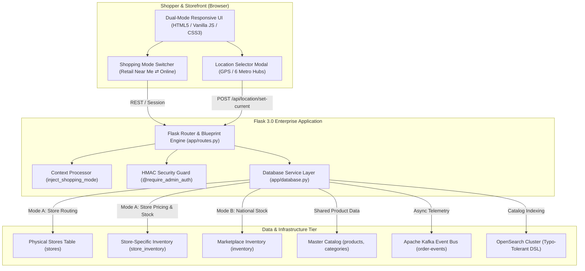

# BharatStore 🇮🇳 | Dual-Mode Omni-Channel Retail Platform & Marketplace

[](https://www.python.org/downloads/)
[](https://palletsprojects.com/p/flask/)
[](https://aiven.io/postgresql)
[](https://aiven.io/kafka)
[](https://aiven.io/opensearch)
[-brightgreen.svg)](#-automated-testing--verification)
[](LICENSE)

**BharatStore** is a modern, location-aware, dual-mode e-commerce and quick-commerce platform designed for India's retail ecosystem. It bridges physical neighborhood grocery stores and supermarkets with an enterprise-scale online marketplace. Customers experience the hyper-local speed of quick commerce (Zepto / Swiggy Instamart / Blinkit) alongside the nationwide selection of a full marketplace (Amazon / Flipkart) — unified within a single Flask-driven platform.

---

## 📑 Table of Contents

- [1. Project Introduction](#1-project-introduction)
- [2. Dual Shopping Modes](#2-dual-shopping-modes)
- [3. Key Platform Capabilities](#3-key-platform-capabilities)
- [4. Phase 4 Multi-Store Inventory Foundation](#4-phase-4-multi-store-inventory-foundation)
- [5. Technology Stack](#5-technology-stack)
- [6. Architecture Diagram](#6-architecture-diagram)
- [7. Database Schema & Relational Design](#7-database-schema--relational-design)
- [8. Installation & Local Setup (Windows PowerShell)](#8-installation--local-setup-windows-powershell)
- [9. Environment Configuration](#9-environment-configuration)
- [10. REST API Documentation](#10-rest-api-documentation)
- [11. Automated Testing & Verification](#11-automated-testing--verification)
- [12. Project Roadmap](#12-project-roadmap)
- [13. Screenshots & Visual Interface](#13-screenshots--visual-interface)
- [14. Security & Concurrency Controls](#14-security--concurrency-controls)
- [15. Contributors & Collaboration](#15-contributors--collaboration)
- [16. License](#16-license)

---

## 1. Project Introduction

### Overview & Problem Statement
Traditional e-commerce platforms force physical retailers to operate as distant drop-shippers with standardized national pricing, masking physical store inventory, local discounts, and hyper-local delivery capability. Conversely, quick-commerce apps restrict shoppers to micro-warehouses (dark stores) without access to comprehensive product ranges, high-ticket electronics, or artisanal heritage goods.

### Project Objectives
1. **Unify Quick Commerce & National Marketplace:** Seamlessly switch between physical store delivery (within 15 km) and nationwide marketplace fulfillment without cart cross-contamination.
2. **True Multi-Store Inventory & Pricing:** Allow physical stores in Bengaluru, Mumbai, and Delhi to stock the same product (e.g. *Fresh Milk 1L* or *Wheat Atta 5kg*) at independent prices and real-time inventory counts.
3. **Resilient Dual-Engine Architecture:** Operate zero-config locally using ACID SQLite, local fuzzy OpenSearch emulation, and in-process Kafka streams, while seamlessly scaling to Aiven Managed PostgreSQL, Kafka, and OpenSearch in production.

---

## 2. Dual Shopping Modes

| Feature / Dimension | 🛒 Mode A: Retail Near Me | 🌐 Mode B: Online Shopping |
| :--- | :--- | :--- |
| **Experience Inspiration** | Zepto, Swiggy Instamart, Zomato Local | Amazon.in, Flipkart |
| **Catalog & Products** | Daily groceries, dairy, fresh vegetables, FMCG | Full 6-category marketplace catalog |
| **Fulfillment Source** | Selected physical retail store / neighborhood hub | Central regional fulfillment mega-hubs |
| **Pricing Engine** | Physical store-specific selling price | National catalog selling price |
| **Stock Tracking** | Real-time `store_inventory` row-level stock | Central `inventory` double-entry ledger |
| **Delivery Radius** | Strict 15 km local radius based on GPS / PIN | Nationwide delivery across India |
| **Cart Isolation** | Retains local store items in isolated basket | Retains marketplace items independently |
| **Order Tracking** | Express delivery with local hub routing | BlueDart tracking timeline & tax invoices |

---

## 3. Key Platform Capabilities

- **Editorial Design System:** High-contrast palette (`#A56211` Warm Honey Gold, `#004B8D` Royal Navy, `#2C2621` Espresso) with Playfair Display and Plus Jakarta Sans typography.
- **Persistent Theme Toggle:** Accessible Light and Dark modes with automatic OS `prefers-color-scheme` synchronization.
- **Smart OpenSearch Bar:** Live fuzzy autocomplete suggestions with typo tolerance (`bluetoth` $\to$ Sony WH-1000XM5, `lapop` $\to$ Dell XPS 13).
- **Location & Address Book (Phase 3):**
  - High-precision GPS Geolocation API with Haversine distance math.
  - Interactive Location Selector Modal (`#location-selector-modal`) supporting 6 Indian metro hubs (Mumbai, Bengaluru, Delhi NCR, Hyderabad, Chennai, Kolkata).
  - Saved Delivery Addresses book with default toggles, phone validation, and checkout auto-fill.
- **Live Event Stream Inspector (`/architecture`):** Real-time Server-Sent Events (SSE) reflecting Kafka events directly in the browser.

---

## 4. Phase 4 Multi-Store Inventory Foundation

Phase 4 establishes complete inventory decentralization across physical retail stores:

1. **Physical Store Database (`stores`):** Captures store details, unique slug, owner, verified contact phone, GPS coordinates, opening/closing hours, active status, and delivery/pickup availability.
2. **Multi-Store Inventory Engine (`store_inventory`):** Maps `(store_id, product_id)` with independent selling prices, stock quantities, reserved counts, and low-stock alerts.
3. **Store-Specific Availability & Price Differentiation:**
   - *Amul Taaza Milk 1L:* ₹60 (20 units) at Bengaluru Tech Store vs. ₹62 (8 units) at Fresh Mart Bengaluru.
   - *Mother Dairy Curd 500g:* In Stock (10 units) at Bengaluru Tech Store vs. **Out of Stock** (0 units) at Fresh Mart Bengaluru.
4. **Overselling & Concurrency Protection:** Atomic row-level stock decrements (`stock_quantity = stock_quantity - ? WHERE stock_quantity >= ?`) and reservations preventing race conditions.
5. **Admin Foundation:** Protected APIs for store registration, inline inventory updates, stock restocking, and low-stock threshold queries.

---

## 5. Technology Stack

- **Backend Framework:** Python 3.10+, Flask 3.0.0, Flask-CORS 4.0.0
- **Database Engine:**
  - *Cloud Production:* Aiven Managed PostgreSQL (`psycopg2-binary`)
  - *Local Development Fallback:* ACID-compliant SQLite 3 (`sqlite3`) with row factories and WAL mode
- **Event Streaming:** Apache Kafka (`kafka-python-ng`) with real-time browser SSE broadcasting
- **Search Engine:** OpenSearch 2.x (`opensearch-py`) with typo-tolerant fuzzy multi-match DSL
- **Frontend / UI:** Vanilla JavaScript (ES6+), HTML5, CSS3 Custom Properties, Jinja2 template inheritance
- **Security & Cryptography:** HMAC SHA-256 timing-safe token authentication, `secrets.token_hex(32)`, parameterized SQL injection guards

---

## 6. Architecture Diagram



---

## 7. Database Schema & Relational Design

The system implements 25 relational tables with strict referential integrity:

```
┌───────────────────────────┐             ┌───────────────────────────┐
│          stores           │             │         products          │
├───────────────────────────┤             ├───────────────────────────┤
│ id (PK)                   │             │ id (PK)                   │
│ store_name                │             │ sku (UNIQUE)              │
│ store_slug (UNIQUE)       │             │ title                     │
│ full_address              │             │ brand                     │
│ city, area, pincode       │             │ category                  │
│ latitude, longitude       │             │ price (national default)  │
│ is_active                 │             │ image_url                 │
└─────────────┬─────────────┘             └─────────────┬─────────────┘
              │                                         │
              │         ┌─────────────────────┐         │
              └────────►│   store_inventory   │◄────────┘
                        ├─────────────────────┤
                        │ id (PK)             │
                        │ store_id (FK)       │
                        │ product_id (FK)     │
                        │ selling_price       │
                        │ original_price      │
                        │ stock_quantity      │
                        │ reserved_quantity   │
                        │ low_stock_threshold │
                        │ is_available        │
                        │ UNIQUE(store, prod) │
                        └─────────────────────┘
```

---

## 8. Installation & Local Setup (Windows PowerShell)

Follow these steps to run BharatStore locally:

### 1. Clone the repository
```powershell
git clone https://github.com/ayush35099-cloud/BharatStore.git
Set-Location BharatStore
```

### 2. Prepare Virtual Environment
```powershell
python -m venv .venv
.\.venv\Scripts\Activate.ps1
```

### 3. Install Dependencies
```powershell
pip install -r requirements.txt
```

### 4. Configure Environment Variables
```powershell
Copy-Item .env.example .env
```

Generate cryptographically secure keys:
```powershell
python -c "import secrets; print('SECRET_KEY=' + secrets.token_hex(32)); print('ADMIN_API_KEY=' + secrets.token_hex(32))"
```
Open `.env` in your editor and paste your generated keys.

### 5. Run Database Migrations
Migrations run **automatically and idempotently** on server startup. To verify manually:
```powershell
python -m unittest tests/test_phase4_store_inventory.py
```

### 6. Start the Flask Application
```powershell
python run.py
```

Open your browser to:
- **Homepage:** [http://127.0.0.1:5000/](http://127.0.0.1:5000/)
- **Retail Near Me:** [http://127.0.0.1:5000/retail](http://127.0.0.1:5000/retail)
- **Online Marketplace:** [http://127.0.0.1:5000/products](http://127.0.0.1:5000/products)
- **Mode Selector:** [http://127.0.0.1:5000/select-mode](http://127.0.0.1:5000/select-mode)
- **Architecture & Streaming Inspector:** [http://127.0.0.1:5000/architecture](http://127.0.0.1:5000/architecture)

---

## 9. Environment Configuration

| Variable | Required | Default / Fallback | Description |
| :--- | :---: | :--- | :--- |
| `PORT` | Optional | `5000` | Port for the local Flask server |
| `SECRET_KEY` | **Required** | *Auto-generated on launch* | Cryptographic 256-bit key for session signing |
| `ADMIN_API_KEY` | **Required** | `""` | Timing-safe secret token for administrative APIs |
| `MAX_QUANTITY_PER_ITEM`| Optional | `50` | Maximum units per cart line item |
| `ALLOW_INSECURE_TEST_ENDPOINTS` | Optional | `false` | Security guard to disable mock routes in production |
| `AIVEN_PG_URL` | Optional | *SQLite local fallback* | PostgreSQL connection string for Aiven Cloud |
| `AIVEN_KAFKA_BOOTSTRAP_SERVERS`| Optional | *In-memory SSE stream* | Apache Kafka bootstrap broker addresses |
| `AIVEN_OPENSEARCH_URL` | Optional | *Local fuzzy DSL engine* | OpenSearch cluster endpoint |
| `RAZORPAY_KEY_ID` | Optional | *Simulated checkout* | Razorpay API key ID for live transactions |

---

## 10. REST API Documentation

### Public Customer Endpoints

#### `GET /api/stores`
Returns active physical stores. Supports optional filters: `?city=Bengaluru&area=Indiranagar`.
```json
{
  "success": true,
  "count": 4,
  "stores": [
    {
      "id": 1,
      "store_name": "BharatStore Bengaluru Tech Store",
      "store_slug": "bharatstore-bengaluru-tech-store",
      "city": "Bengaluru",
      "area": "Indiranagar",
      "pincode": "560038",
      "latitude": 12.9784,
      "longitude": 77.6408,
      "opening_time": "06:30 AM",
      "closing_time": "11:30 PM",
      "accepts_delivery": true,
      "accepts_pickup": true
    }
  ]
}
```

#### `GET /api/stores/<store_id>/products`
Returns in-stock items available at the specific physical store.
```json
{
  "success": true,
  "store_id": 1,
  "store_name": "BharatStore Bengaluru Tech Store",
  "count": 19,
  "products": [
    {
      "product_id": 61,
      "title": "Amul Taaza Homogenised Toned Milk 1L",
      "selling_price": 60.00,
      "original_price": 64.00,
      "stock_quantity": 20,
      "is_available": true
    }
  ]
}
```

#### `GET /api/stores/<store_id>/products/<product_id>`
Returns specific store pricing and stock availability.

---

### Protected Administrative Endpoints
*Requires header: `X-Admin-Token: <ADMIN_API_KEY>` or `Authorization: Bearer <ADMIN_API_KEY>`*

#### `POST /api/stores/<store_id>/inventory`
Adds a product to store inventory with custom store pricing.
```json
// Request Body
{
  "product_id": 16,
  "selling_price": 530.00,
  "original_price": 540.00,
  "stock_quantity": 40,
  "low_stock_threshold": 8
}
```

#### `PUT /api/stores/<store_id>/inventory/<product_id>`
Modifies price or stock level at the specified physical store.

#### `DELETE /api/stores/<store_id>/inventory/<product_id>`
Removes a product from store inventory.

#### `GET /api/stores/<store_id>/inventory/low-stock`
Returns items where `(stock_quantity - reserved_quantity) <= low_stock_threshold`.

---

## 11. Automated Testing & Verification

All 71 automated tests across Phase 1, Phase 2, Phase 3, and Phase 4 are executed and verified:

```powershell
python -m unittest discover tests -v
```

### Verified Test Summary

```text
----------------------------------------------------------------------
Ran 71 tests in 0.685s

OK (100% Passed)
```

- **Phase 4 Multi-Store Inventory Suite (`tests/test_phase4_store_inventory.py`):** 21 / 21 PASS
  - Store creation, retrieval, updates, activation/deactivation cycles.
  - Independent store pricing (₹60 vs ₹62 for Milk 1L).
  - Out-of-stock isolation (Curd available at Store 1, unavailable at Store 2).
  - Concurrency safety, overselling prevention, and stock reservation lifecycle.
  - Negative values and duplicate inventory rejection (`HTTP 400`, `HTTP 409`).
  - Unauthorized mutations blocked with `HTTP 403`.
- **Phase 3 Location & Addresses Suite (`tests/test_phase3_location_management.py`):** 21 / 21 PASS
  - GPS coordinates validation, Indian PIN / phone regex, customer ownership (IDOR).
- **Phase 2 Shopping Modes Suite (`tests/test_phase2_shopping_modes.py`):** 17 / 17 PASS
  - Dual-mode session switching, cart separation, modal confirmations.
- **Phase 2 Product Details Suite (`tests/test_phase2_product_detail.py`):** 12 / 12 PASS
  - 18 Phase 1 modules regression guard, OpenSearch fuzzy typo tolerance.

---

## 12. Project Roadmap

- [x] **Phase 1: Platform Foundation & Core E-Commerce** (18 modules, Aiven Cloud integrations, dual SQLite/PG engine).
- [x] **Phase 2: Dual Shopping Mode Selection Engine** (Retail Near Me ⇄ Online Shopping, isolated carts).
- [x] **Phase 3: Location and Address Management** (GPS detection, 6 metro hubs, address book CRUD, zero horizontal scroll).
- [x] **Phase 4: Store Database & Multi-Store Inventory** (Physical store models, independent pricing, overselling protection).
- [ ] **Phase 5: Hyper-Local Store Discovery & 15 km Radius Routing** (Map views, dynamic store comparison, tiered delivery fees).
- [ ] **Phase 6: Admin Store Portal & Partner Merchant Dashboard** (Merchant web UI, inventory reconciliation, order dispatch).

---

## 13. Screenshots & Visual Interface

| Mode A: Retail Near Me (Quick Commerce) | Location Selector Modal (GPS & Metro) |
| :---: | :---: |
|  |  |
| *15-Minute Local Delivery with dynamic nearest hub* | *GPS detection & 6 Indian metro hub picker* |

---

## 14. Security & Concurrency Controls

1. **Timing-Safe HMAC Authentication:** Administrative API endpoints verify credentials using `hmac.compare_digest` to prevent side-channel timing attacks.
2. **ACID Concurrency & Row Locking:** Store stock reservations use atomic decrements and row-level locks (`FOR UPDATE` on PostgreSQL; immediate transactions on SQLite) to prevent overselling under high concurrency.
3. **Insecure Direct Object Reference (IDOR) Protection:** Address operations verify `customer_id` ownership, returning `404 Not Found` for unauthorized tampering attempts.
4. **Injection Defenses:** Parameterized queries (`?` on SQLite, `%s` on PostgreSQL) ensure immunity against SQL injection attacks.
5. **Zero-Secret Public Codebase:** `.env` is strictly git-ignored; sample configuration uses placeholders only.

---

## 15. Contributors & Collaboration

- **Ayush Anjan Choudhary** ([@ayush35099-cloud](https://github.com/ayush35099-cloud)) — *Full-Stack Architecture, Database Engineering & Cloud Infrastructure*
- **Team Collaborators** — *Frontend UI/UX, Component Theming & Voice Search Integrations*

---

## 16. License

This project is licensed under the terms of the [MIT License](LICENSE).

---

*BharatStore 🇮🇳 — Physical Stores Across India, Now Online.*
