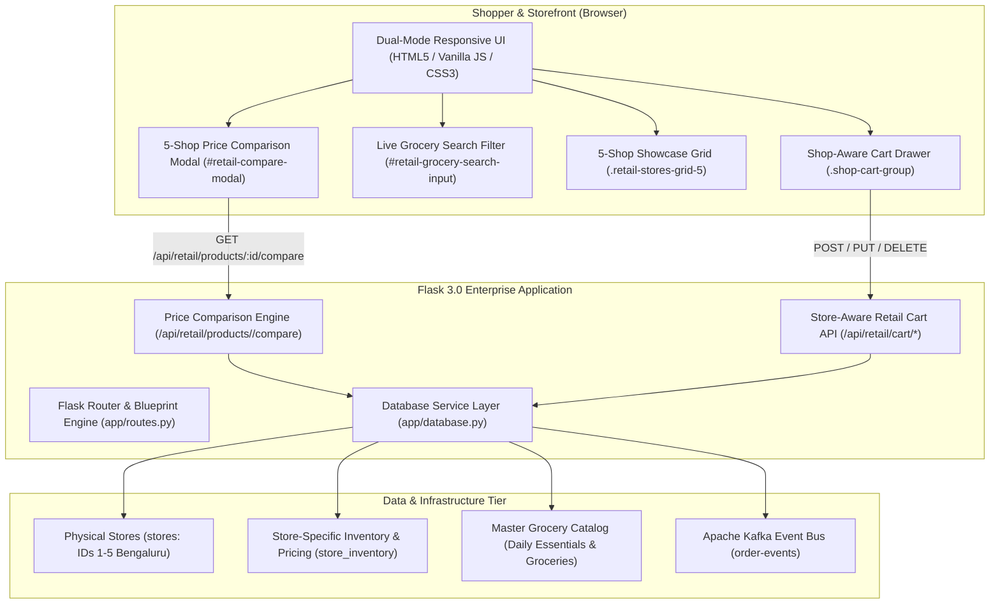

# BharatStore 🇮🇳 | Dual-Mode Omni-Channel Retail Platform & Marketplace

[](https://www.python.org/downloads/)
[](https://palletsprojects.com/p/flask/)
[](https://aiven.io/postgresql)
[](https://aiven.io/kafka)
[](https://aiven.io/opensearch)
[-brightgreen.svg)](#-automated-testing--verification)
[](LICENSE)

**BharatStore** is a modern, location-aware, dual-mode e-commerce and quick-commerce platform designed for India's retail ecosystem. It bridges physical neighborhood grocery stores and supermarkets with an enterprise-scale online marketplace. Customers experience the hyper-local speed of quick commerce (Zepto / Swiggy Instamart / Blinkit) alongside the nationwide selection of a full marketplace (Amazon / Flipkart) — unified within a single Flask-driven platform.

> **Key Proposition for Retail Near Me:**  
> *"Compare prices across five neighbourhood shops and buy at the price you prefer."*

---

## 📑 Table of Contents

- [1. Project Introduction](#1-project-introduction)
- [2. Dual Shopping Modes](#2-dual-shopping-modes)
- [3. Key Platform Capabilities](#3-key-platform-capabilities)
- [4. Five-Shop Retail Grocery Marketplace & Price Comparison](#4-five-shop-retail-grocery-marketplace--price-comparison)
- [5. Multi-Store Inventory Foundation](#5-multi-store-inventory-foundation)
- [6. Multi-Store Cart & Checkout Architecture (Phase 7)](#6-multi-store-cart--checkout-architecture-phase-7)
- [7. Store-Specific Inventory & Stock Management (Phase 8)](#7-store-specific-inventory--stock-management-phase-8)
- [8. Technology Stack](#8-technology-stack)
- [9. Architecture Diagram](#9-architecture-diagram)
- [10. Database Schema & Relational Design](#10-database-schema--relational-design)
- [11. Installation & Local Setup (Windows PowerShell)](#11-installation--local-setup-windows-powershell)
- [12. Environment Configuration](#12-environment-configuration)
- [13. REST API Documentation](#13-rest-api-documentation)
- [14. Automated Testing & Verification](#14-automated-testing--verification)
- [15. Project Roadmap](#15-project-roadmap)
- [16. Security & Concurrency Controls](#16-security--concurrency-controls)
- [17. Contributors & Collaboration](#17-contributors--collaboration)
- [18. License](#18-license)

---

## 1. Project Introduction

### Overview & Problem Statement
Traditional e-commerce platforms force physical retailers to operate as distant drop-shippers with standardized national pricing, masking physical store inventory, local discounts, and hyper-local delivery capability. Conversely, quick-commerce apps restrict shoppers to micro-warehouses (dark stores) without access to comprehensive product ranges, price comparisons between neighborhood shops, or high-ticket electronics.

### Project Objectives
1. **Unify Quick Commerce & National Marketplace:** Seamlessly switch between physical store delivery (within 15 km) and nationwide marketplace fulfillment without cart cross-contamination.
2. **Five-Shop Grocery Price Comparison:** Allow customers to browse five verified neighborhood grocery shops in Bengaluru, compare real-time prices on everyday essentials, and purchase from the store offering the best price.
3. **True Multi-Store Inventory & Pricing:** Allow physical stores to stock the same products at independent prices (with realistic ₹1–₹3 variances) and isolated stock levels (including out-of-stock isolation).
4. **Resilient Dual-Engine Architecture:** Operate zero-config locally using ACID SQLite, local fuzzy OpenSearch emulation, and in-process Kafka streams, while seamlessly scaling to Aiven Managed PostgreSQL, Kafka, and OpenSearch in production.

---

## 2. Dual Shopping Modes

| Feature / Dimension | 🛒 Mode A: Retail Near Me | 🌐 Mode B: Online Shopping |
| :--- | :--- | :--- |
| **Experience Inspiration** | Zepto, Swiggy Instamart, Blinkit, Local Shops | Amazon.in, Flipkart |
| **Catalog & Products** | Strictly Daily Groceries, Dairy, Staples & Produce (0 Electronics) | Full 7-category marketplace catalog (Laptops, Mobiles, Apparel, Home) |
| **Fulfillment Source** | 5 Verified Bengaluru neighborhood physical retail shops | Central regional fulfillment mega-hubs |
| **Pricing Engine** | Physical shop-specific selling price (₹1–₹3 variations) | National catalog selling price |
| **Price Comparison** | Real-time 5-shop price comparison modal & lowest price badges | Single marketplace price with coupon discounts |
| **Stock Tracking** | Real-time `store_inventory` row-level stock | Central `inventory` double-entry ledger |
| **Delivery Radius** | Strict 15 km local radius with fast doorstep dispatch | Nationwide delivery across India |
| **Cart Isolation** | Retains local shop items with shop-wise subtotals | Retains marketplace items independently |
| **Fulfillment Options**| Reliable Doorstep Delivery from local partner store | Standard Courier & Surface Logistics |

---

## 3. Key Platform Capabilities

- **Editorial Design System:** High-contrast palette (`#A56211` Warm Honey Gold, `#004B8D` Royal Navy, `#2C2621` Espresso) with Playfair Display and Plus Jakarta Sans typography.
- **Persistent Theme Toggle:** Accessible Light and Dark modes with automatic OS `prefers-color-scheme` synchronization.
- **Smart OpenSearch Bar:** Live fuzzy autocomplete suggestions with typo tolerance (`bluetoth` $\to$ Sony WH-1000XM5, `lapop` $\to$ Dell XPS 13).
- **Location & Address Book (Phase 3):**
  - High-precision GPS Geolocation API with Haversine distance math.
  - Interactive Location Selector Modal (`#location-selector-modal`) supporting 6 Indian metro hubs (Mumbai, Bengaluru, Delhi NCR, Hyderabad, Chennai, Kolkata).
  - Saved Delivery Addresses book with default toggles, phone validation, and checkout auto-fill.
- **Live Event Stream Inspector (`/architecture`):** Real-time Server-Sent Events (SSE) reflecting Kafka events directly in the browser.

---

## 4. Five-Shop Retail Grocery Marketplace & Price Comparison

The Retail Near Me storefront has been transformed into a hyper-local grocery shopping and price comparison platform:

### 1. Five Verified Bengaluru Retail Shops
Customers can switch between five authentic neighborhood grocery stores located across prime Bengaluru localities:
1. **Bharat Fresh Mart** (Store ID: 1, Indiranagar, 12.9784, 77.6408) — *Rating: 4.8★, Delivery: 15-20 min, Min Order: ₹99*
2. **Daily Needs Supermarket** (Store ID: 2, Koramangala, 12.9352, 77.6245) — *Rating: 4.6★, Delivery: 25-30 min, Min Order: ₹149*
3. **Green Basket Grocery** (Store ID: 3, HSR Layout, 12.9121, 77.6446) — *Rating: 4.9★, Delivery: 20-25 min, Min Order: ₹99*
4. **Sri Lakshmi Stores** (Store ID: 4, Jayanagar, 12.9308, 77.5838) — *Rating: 4.7★, Delivery: 30-35 min, Min Order: ₹199*
5. **Smart Choice Supermarket** (Store ID: 5, Whitefield, 12.9698, 77.7500) — *Rating: 4.5★, Delivery: 35-40 min, Min Order: ₹249*

### 2. Strict Grocery-Only Isolation
The Retail storefront strictly filters catalog items to `category == "Daily Essentials & Groceries"`. Laptops, smartphones, audio gear, apparel, and non-grocery merchandise are strictly excluded from `/retail`.

### 3. Comprehensive 50+ Everyday Grocery Catalog
Over 60 everyday grocery items organized across five essential departments:
- **Dairy & Breakfast (13 items):** Amul Taaza Milk 1L, Amul Gold Milk 500ml, Mother Dairy Milk 1L, Fresh Curd 500g, Amul Masti Dahi 400g, Paneer 200g, Amul Butter 100g, Amul Pure Ghee 500ml, Cheese 200g, Bread, Eggs, Oats, Corn Flakes.
- **Rice & Grains (11 items):** Basmati Rice 1kg, Regular Rice 5kg, Wheat Atta 5kg, Toor Dal 1kg, Moong Dal 1kg, Chana Dal, Urad Dal, Rajma, Poha, Besan, Suji.
- **Cooking Essentials (12 items):** Sunflower Oil 1L, Mustard Oil 1L, Sugar 1kg, Salt 1kg, Turmeric Powder, Red Chilli Powder, Coriander Powder, Garam Masala, Tea, Coffee, Cumin Seeds, Mustard Seeds.
- **Fresh Produce (10 items):** New Crop Potatoes 1kg, Nasik Red Onions 1kg, Hybrid Tomatoes 1kg, Robusta Bananas 1 Dozen, Coriander Bunch, Green Chillies, Ginger, Apples, Oranges, Capsicum.
- **Household Essentials (8 items):** Surf Excel Easy Wash 1kg, Vim Dishwash Gel 500ml, Lizol Floor Cleaner 1L, Dettol Handwash 675ml, Harpic 1L, Colin Glass Cleaner, Goodknight Refill, Scotch-Brite Sponges.

### 4. Real Database Store-Specific Pricing & Stock Variance
Prices reflect real-world market variations with realistic ₹1–₹3 variances:
- *Amul Taaza Milk 1L:* ₹60 at Bharat Fresh Mart vs ₹62 at Daily Needs Supermarket.
- *Amul Pure Ghee 500ml:* ₹310 at Store 1, ₹312 at Store 3, ₹309 at Store 4 (Lowest price!).
- *Paneer 200g:* ₹95 at Store 1, ₹92 at Store 3 (Lowest), ₹98 at Store 2, and Out of Stock at Store 4.
- *Out-of-Stock Isolation:* Store 2 has Curd and Ghee out of stock; Store 4 has Paneer out of stock. Customers cannot add out-of-stock items, while other shops maintain active stock.

### 5. Interactive 5-Shop Price Comparison Modal
Every product card features a **"Compare 5 Shops"** button. Clicking opens a real-time comparison modal showing:
- Image, title, unit pack size.
- Real-time price breakdown across all 5 Bengaluru shops.
- Green badge highlighting the shop offering the **Lowest Price** along with the exact rupee savings.
- Per-shop stock status (In Stock with count vs Out of Stock).
- Direct **"Buy from Shop"** action button for immediate fulfillment from the selected store.

### 6. Shop-Aware Cart with Subtotals & Fulfillment Selection
- Cart items are tagged with `store_id` and `store_name`.
- Cart drawer dynamically groups items by shop with individual shop subtotals.
- Customers can toggle between **2-Hour Express Delivery (₹20)** and **Free Store Pickup** per shop.

---

## 5. Multi-Store Inventory Foundation

Phase 4 establishes complete inventory decentralization across physical retail stores:

1. **Physical Store Database (`stores`):** Captures store details, unique slug, owner, verified contact phone, GPS coordinates, opening/closing hours, active status, and delivery/pickup availability.
2. **Multi-Store Inventory Engine (`store_inventory`):** Maps `(store_id, product_id)` with independent selling prices, stock quantities, reserved counts, and low-stock alerts.
3. **Overselling & Concurrency Protection:** Atomic row-level stock decrements (`stock_quantity = stock_quantity - ? WHERE stock_quantity >= ?`) and reservations preventing race conditions.
4. **Admin Foundation:** Protected APIs for store registration, inline inventory updates, stock restocking, and low-stock threshold queries.

---

## 6. Multi-Store Cart & Checkout Architecture (Phase 7)

Phase 7 implements a robust, database-backed, multi-store shopping cart and checkout architecture that permanently resolves cart synchronization bugs, supports simultaneous independent baskets across multiple physical grocery stores, calculates distance-based delivery fees, and executes atomic ACID row-locking checkouts.

### 1. Three Independent Cart Scopes
The platform maintains complete isolation across shopping environments:
1. **Online Shopping Cart (`shopping_mode = 'ONLINE', store_id = NULL`):**
   - Strictly accepts only marketplace items (laptops, phones, electronics, fashion).
   - Attempts to add daily groceries are rejected by the backend with HTTP 400.
   - Independent item count, subtotal, and checkout flow.
2. **Retail Store-Specific Carts (`shopping_mode = 'RETAIL_NEAR_ME', store_id = <id>`):**
   - Each physical grocery store maintains an isolated basket in the database.
   - Prices reflect the specific store's selling price (e.g., Amul Milk ₹60 at Store 1 vs ₹62 at Store 2).
   - Validates live stock quantity against `store_inventory` before adding or updating.
   - Customers can build baskets in Store 1, Store 2, and Store 3 simultaneously without cross-store interference.
3. **Master Retail Cart View (`/cart`):**
   - Displays all active retail baskets grouped by physical store.
   - Shows store badges, distance labels, individual store subtotals, and delivery fee calculations.
   - Per-store fulfillment selector: **2-Hour Express Delivery** (tiered fee) vs **In-Store Pickup** (₹0).
   - Flexible checkout triggers: checkout a single store or select multiple stores for unified parent checkout.

### 2. Permanent Fix for Stale Cart Preview Bug
In previous versions, client-side `localStorage` caching could drift from the server session, causing phantom or deleted items to reappear on browser refresh. Phase 7 permanently eliminates this issue:
- **Server Database as Sole Authority:** Cart item counts, prices, availability, and totals are computed strictly from the database.
- **Bi-Directional Client Synchronization:** `syncCartWithBackend()` runs on initial page load and after every mutation.
- **Client Cache Purge:** When a cart is cleared, all items are deleted, or a user logs out (`/api/auth/logout`), client-side `localStorage` keys are explicitly purged.
- **Zero Phantom Items:** Refreshing the browser or opening new tabs guarantees 0 phantom items on an empty cart.
- **Strict IDOR & Guest Partitioning:** Cross-customer cart modifications are blocked with HTTP 403; guest carts are strictly partitioned by `session_id`.

### 3. Hyperlocal Distance-Based Delivery Fee Engine
Delivery fees for physical grocery stores are calculated using Haversine distance math based on customer coordinates and the store's physical location:
- **Tier 1 (0 – 5 km):** ₹20.00
- **Tier 2 (5 – 10 km):** ₹40.00
- **Tier 3 (10 – 15 km):** ₹60.00
- **Store Counter Pickup:** ₹0.00 (Free for all distances)
- **Outside Service Radius (> 15 km):** Delivery is blocked; customers are prompted to choose in-store pickup.

### 4. Multi-Store ACID Row-Locking Checkout
- **Single-Store Retail Checkout:** Creates a single retail order in `orders` table (`store_id` populated, `parent_order_id = NULL`) in status `CONFIRMED`.
- **Multi-Store Retail Checkout:** Atomically creates a master parent order (`BK-RET-P-XXXX`) and individual suborders for each selected store (`BK-RET-S{id}-XXXX`), linking `parent_order_id` to the master order.
- **Atomic Stock Commit & Rollback:** Uses `atomic_commit_store_sale` with row-level locks. If any item in the order has insufficient stock, the entire transaction rolls back cleanly with zero overselling.
- **Selective Cart Conversion:** Checked-out store baskets are marked as `CONVERTED`, while unselected store carts remain active in the customer's account.

---

## 7. Store-Specific Inventory & Stock Management (Phase 8)

Phase 8 introduces enterprise-grade physical store inventory and stock management, strict grocery isolation for Retail Near Me, and permanent resolution of the ₹NaN price comparison bug.

### 1. Strict Retail Grocery Isolation
- **8 Exact Grocery Categories Allowed:** `Dairy & Breakfast`, `Rice & Grains`, `Cooking Essentials`, `Fresh Produce`, `Snacks & Beverages`, `Household Essentials`, `Personal Care`, `Packaged Foods`.
- **Complete Elimination of Non-Grocery Products in Retail Mode:** Electronics, Laptops, Mobiles, Fashion, Audio, and Home Appliances are strictly blocked in Retail Near Me navigation, search suggestions, catalog APIs (`/api/products`), search endpoint (`/api/search`), and direct product lookups (`/api/products/<id>`).
- **Preserved Online Shopping Catalog:** Online Shopping continues to offer the full cross-category national marketplace catalog without modification.

### 2. Resolution of ₹NaN Price Comparison Bug
- Corrected backend API key mapping (`db_service.get_product_price_comparison` now consistently provides both `price` and `selling_price` numeric floats).
- Comprehensive frontend numerical sanitization: handles missing prices gracefully ("Price unavailable"), excludes out-of-stock shops from being marked as the lowest price, and prevents `NaN`, `null`, `undefined`, or `Infinity` from ever rendering in the UI.

### 3. Store-Specific Stock Management & Immutable Audit Ledger
- **Independent Inventory:** Every physical store manages its own stock quantities, selling prices, and low-stock thresholds independently. Altering stock in Store 1 has zero effect on Store 2.
- **Stock Movement Ledger (`inventory_movements`):** All inventory events (`RESTOCKED`, `ADJUSTED`, `SOLD`) are recorded in an append-only audit trail with `quantity`, `balance_after`, `reference_type`, and store-specific metadata.
- **Live Stock Tracking:** Real-time identification of out-of-stock items (`stock_quantity <= 0` or `is_available = false`) and low-stock alerts when inventory drops below threshold.
- **Row-Level ACID Checkout Decrements:** When orders are committed, store stock is decremented using database row locks (`FOR UPDATE`), rolling back atomically on any stock shortfall.
- **Timing-Safe Admin Security:** All store inventory management endpoints are strictly guarded with `require_admin_auth` HMAC token verification.

---

## 8. Phase 14: Complete UI/UX Polish, Address Management & Simplified Categories

Phase 14 delivers comprehensive UI/UX refinement across both shopping modes:

### 1. Saved Address Management
- **5-Address Server Enforcement:** Maximum 5 saved delivery addresses per customer strictly enforced at the backend database and API level.
- **Duplicate Address Prevention:** Rejects duplicate addresses matching on street address line 1, city, and 6-digit postal PIN code (case-insensitive and trimmed).
- **Full Address Lifecycle:** Seamless editing, deleting, and selecting primary default address, automatically prefilled on checkout.
- **Clear User Messaging:** Prompts with `"Maximum limit of 5 saved addresses reached. Please delete an address to add a new one."` when attempting to exceed the limit.

### 2. Streamlined 5 Retail Categories
Retail Near Me catalog is cleanly unified into five essential categories across the UI, search dropdowns, filters, and APIs:
1. **Fruits & Vegetables:** Fresh potatoes, onions, tomatoes, bananas, apples, oranges, ginger, chillies, capsicum, coriander.
2. **Dairy & Bakery:** Amul milk, curd, paneer, butter, ghee, cheese, whole wheat bread, farm fresh eggs.
3. **Rice, Atta & Dal:** Basmati rice, Sona Masoori, Sharbati atta, toor dal, moong dal, chana dal, urad dal, rajma, kabuli chana, poha.
4. **Snacks & Beverages:** Tata Tea Gold/Premium, Bru/Nescafe coffee, rolled oats, corn flakes, Madhur sugar, wild honey.
5. **Household & Personal Care:** Detergents, floor cleaner, dishwash gel, antiseptic, toilet cleaner, cooking oils, table salt, turmeric, chilli powder.

### 3. Authentic Imagery & Hero Separation
- **Online Shopping:** Features modern e-commerce visual of a woman shopping from home using a smartphone and credit/debit card (`/static/images/online-shopping-hero.jpg`).
- **Retail Near Me:** Preserves dedicated local grocery and neighborhood store storefront aesthetics.
- **Authentic Grocery Visuals:** Authentic raw product photography for dals, rice, spices, dairy, and oils with SVG placeholder fallback.

### 4. Search Bar & Navigation Polish
- Search magnifying glass cleanly positioned inside the search input across Online and Retail modes.
- Mode-aware dynamic placeholders and category filters.
- Cart drawer UX with locked background scrolling, sticky header/footer, and responsive word wrapping without clipping.
- Unsupported delivery claims (such as 2-hour promises or pickup confusion) removed in favor of transparent standard doorstep delivery.

---

## 9. Technology Stack

- **Backend Framework:** Python 3.10+, Flask 3.0.0, Flask-CORS 4.0.0
- **Database Engine:**
  - *Cloud Production:* Aiven Managed PostgreSQL (`psycopg2-binary`)
  - *Local Development Fallback:* ACID-compliant SQLite 3 (`sqlite3`) with row factories and WAL mode
- **Event Streaming:** Apache Kafka (`kafka-python-ng`) with real-time browser SSE broadcasting
- **Search Engine:** OpenSearch 2.x (`opensearch-py`) with typo-tolerant fuzzy multi-match DSL
- **Frontend / UI:** Vanilla JavaScript (ES6+), HTML5, CSS3 Custom Properties, Jinja2 template inheritance
- **Security & Cryptography:** HMAC SHA-256 timing-safe token authentication, `secrets.token_hex(32)`, parameterized SQL injection guards

---

## 9. Architecture Diagram



---

## 10. Database Schema & Relational Design

The system implements relational tables with strict referential integrity:

```
┌───────────────────────────┐             ┌───────────────────────────┐
│          stores           │             │         products          │
├───────────────────────────┤             ├───────────────────────────┤
│ id (PK)                   │             │ id (PK)                   │
│ store_name                │             │ sku (UNIQUE)              │
│ store_slug (UNIQUE)       │             │ title                     │
│ full_address              │             │ brand                     │
│ city, area, pincode       │             │ category                  │
│ latitude, longitude       │             │ sub_category              │
│ rating, delivery_time     │             │ price (national default)  │
│ min_order, is_active      │             │ image_url                 │
└─────────────┬─────────────┘             └─────────────┬─────────────┘
              │                                         │
              │         ┌─────────────────────┐         │
              └────────►│   store_inventory   │◄────────┘
                        ├─────────────────────┤
                        │ id (PK)             │
                        │ store_id (FK)       │
                        │ product_id (FK)     │
                        │ selling_price       │
                        │ original_price      │
                        │ stock_quantity      │
                        │ reserved_quantity   │
                        │ low_stock_threshold │
                        │ is_available        │
                        │ UNIQUE(store, prod) │
                        └─────────────────────┘
```

---

## 11. Installation & Local Setup (Windows PowerShell)

Follow these steps to run BharatStore locally:

### 1. Clone the repository
```powershell
git clone https://github.com/ayush35099-cloud/BharatStore.git
Set-Location BharatStore
```

### 2. Prepare Virtual Environment
```powershell
python -m venv .venv
.\.venv\Scripts\Activate.ps1
```

### 3. Install Dependencies
```powershell
pip install -r requirements.txt
```

### 4. Configure Environment Variables
```powershell
Copy-Item .env.example .env
```

Generate cryptographically secure keys:
```powershell
python -c "import secrets; print('SECRET_KEY=' + secrets.token_hex(32)); print('ADMIN_API_KEY=' + secrets.token_hex(32))"
```
Open `.env` in your editor and paste your generated keys.

### 5. Run Database Migrations
Migrations run **automatically and idempotently** on server startup. To verify manually:
```powershell
python -m unittest tests/test_retail_price_comparison.py
```

### 6. Start the Flask Application
```powershell
python run.py
```

Open your browser to:
- **Homepage:** [http://127.0.0.1:5000/](http://127.0.0.1:5000/)
- **Retail Near Me (5-Shop Comparison):** [http://127.0.0.1:5000/retail](http://127.0.0.1:5000/retail)
- **Online Marketplace:** [http://127.0.0.1:5000/?view=online](http://127.0.0.1:5000/?view=online)
- **Mode Selector:** [http://127.0.0.1:5000/select-mode](http://127.0.0.1:5000/select-mode)
- **Architecture & Streaming Inspector:** [http://127.0.0.1:5000/architecture](http://127.0.0.1:5000/architecture)

---

## 12. Environment Configuration

| Variable | Required | Default / Fallback | Description |
| :--- | :---: | :--- | :--- |
| `PORT` | Optional | `5000` | Port for the local Flask server |
| `SECRET_KEY` | **Required** | *Auto-generated on launch* | Cryptographic 256-bit key for session signing |
| `ADMIN_API_KEY` | **Required** | `""` | Timing-safe secret token for administrative APIs |
| `MAX_QUANTITY_PER_ITEM`| Optional | `50` | Maximum units per cart line item |
| `ALLOW_INSECURE_TEST_ENDPOINTS` | Optional | `false` | Security guard to disable mock routes in production |
| `AIVEN_PG_URL` | Optional | *SQLite local fallback* | PostgreSQL connection string for Aiven Cloud |
| `AIVEN_KAFKA_BOOTSTRAP_SERVERS`| Optional | *In-memory SSE stream* | Apache Kafka bootstrap broker addresses |
| `AIVEN_OPENSEARCH_URL` | Optional | *Local fuzzy DSL engine* | OpenSearch cluster endpoint |
| `RAZORPAY_KEY_ID` | Optional | *Simulated checkout* | Razorpay API key ID for live transactions |

---

## 13. REST API Documentation

### Retail Near Me & Price Comparison Endpoints

#### `GET /api/retail/stores`
Returns the five Bengaluru neighbourhood shops with live delivery time, ratings, and min order thresholds.
```json
{
  "success": true,
  "total_stores": 5,
  "city": "Bengaluru",
  "stores": [
    {
      "id": 1,
      "store_name": "Bharat Fresh Mart",
      "area": "Indiranagar",
      "rating": 4.8,
      "delivery_time": "15-20 min",
      "min_order": 99.0
    }
  ]
}
```

#### `GET /api/retail/catalog`
Returns the dynamic retail grocery-only catalog grouped by essential departments, including active store details and top savings deals.
```json
{
  "success": true,
  "dairy_items": [...],
  "grains_items": [...],
  "essentials_items": [...],
  "produce_items": [...],
  "household_items": [...],
  "top_deals": [...]
}
```

#### `GET /api/retail/products/<product_id>/compare`
Calculates real-time price comparison across all five neighbourhood shops for a specific grocery product.
```json
{
  "success": true,
  "product": {
    "id": 79,
    "title": "Amul Pure Ghee – 500 ml",
    "pack_size": "500 ml"
  },
  "lowest_price": 309.0,
  "highest_price": 312.0,
  "max_savings": 3.0,
  "lowest_store_id": 4,
  "lowest_store_name": "Sri Lakshmi Stores",
  "stores_comparison": [
    {
      "store_id": 1,
      "store_name": "Bharat Fresh Mart",
      "selling_price": 310.0,
      "stock_quantity": 25,
      "is_available": true,
      "is_lowest": false
    },
    {
      "store_id": 4,
      "store_name": "Sri Lakshmi Stores",
      "selling_price": 309.0,
      "stock_quantity": 30,
      "is_available": true,
      "is_lowest": true
    }
  ]
}
```

#### `POST /api/retail/cart/add`
Adds a product to the retail basket from a designated physical store with inventory and out-of-stock validation.
```json
// Request Body
{
  "product_id": 61,
  "store_id": 1,
  "quantity": 2,
  "store_name": "Bharat Fresh Mart",
  "fulfillment": "delivery"
}
```

#### `GET /api/retail/cart`
Returns the active retail cart grouped by shop with calculated subtotals, fulfillment breakdown, and grand totals.

#### `PUT /api/retail/cart/update`
Updates quantity or fulfillment mode (`delivery` / `pickup`) for a specific shop item.

#### `DELETE /api/retail/cart/remove`
Removes an item from the shop-aware retail cart.

#### `GET /api/retail/stores/nearby?lat={lat}&lng={lng}&radius=15`
Discovers active physical grocery stores within a maximum radius of 15 km using the Haversine spherical distance formula ($R = 6371\text{ km}$). Distances are calculated and labeled as approximate straight-line distances. Supports sorting (`nearest`, `farthest`, `name_asc`, `fee_asc`) and filtering (`category`, `open_now`, `delivery`, `pickup`).
```json
{
  "status": "success",
  "customer_location": {
    "lat": 12.9784,
    "lng": 77.6408,
    "address": "Indiranagar, Bengaluru"
  },
  "max_radius_km": 15.0,
  "count": 5,
  "stores": [
    {
      "id": 1,
      "store_name": "Bharat Fresh Mart",
      "address": "Shop 4, CMH Road, Indiranagar",
      "distance_km": 0.0,
      "distance_label": "0.0 km approx. straight-line distance",
      "is_open": true,
      "opening_time": "06:30 AM",
      "closing_time": "11:00 PM",
      "delivery_available": true,
      "pickup_available": true,
      "delivery_fee": 15.0,
      "grocery_count": 62
    }
  ]
}
```

#### `GET /api/retail/stores/<store_id>`
Fetches detailed profile, operational hours, rating, and live inventory count for a specific physical grocery store.

#### `GET /retail/stores`
Web directory view listing all physical grocery stores within 15 km with interactive sorting, department filtering, operational status badges, and 1-click store selection.

#### `GET /retail/store/<store_id>`
Dynamic individual store front displaying the physical store's verified grocery inventory across all 5 departments, real-time in-store search, and instant basket checkout.

### Phase 7: Multi-Store Cart & Checkout Endpoints

#### Online Shopping Cart APIs
- `GET /api/cart/online`: Retrieves active Online shopping cart with live catalog prices and stock.
- `POST /api/cart/online/add`: Adds an online marketplace product to the Online cart. Rejects grocery items with HTTP 400.
  - Body: `{"product_id": 1, "quantity": 1}`
- `POST /api/cart/online/clear`: Clears all items from the Online shopping cart.

#### Retail Store-Specific Cart APIs
- `GET /api/cart/retail`: Retrieves all active retail baskets grouped by physical store with delivery fee calculations and grand totals.
- `GET /api/cart/retail/<store_id>`: Retrieves active basket for a specific physical grocery store with store-specific pricing.
- `POST /api/cart/retail/<store_id>/add`: Adds a grocery item to the specified store's basket. Rejects out-of-stock items or quantities exceeding store stock.
  - Body: `{"product_id": 61, "quantity": 2, "fulfillment": "delivery"}`
- `POST /api/cart/retail/<store_id>/clear`: Clears items from the specified store's basket.
- `POST /api/cart/retail/clear`: Clears all retail baskets across all physical stores.

#### Unified Cart Summary & Line-Item Mutations
- `GET /api/cart/summary`: Returns unified cart counts (`total_items`, `subtotal`, `grand_total`) across both Online and Retail modes.
- `PATCH /api/cart/items/<item_id>`: Updates item quantity (or fulfillment: `delivery`/`pickup`). Setting quantity to 0 removes the item. Validates customer ownership (IDOR protection).
  - Body: `{"quantity": 3, "fulfillment": "pickup"}`
- `DELETE /api/cart/items/<item_id>`: Deletes a specific line item from the database cart. Validates customer ownership.

#### Checkout APIs (ACID Row-Locking)
- `POST /api/checkout/online`: Executes independent Online Shopping checkout with row-level stock decrements and converts the online cart.
  - Body: `{"customer_info": {...}, "payment_method": "UPI"}`
- `POST /api/checkout/retail/multi-store`: Executes multi-store retail checkout. Creates single retail order (if 1 store) or parent master order (`BK-RET-P-`) with suborders (`BK-RET-S{id}-`) per store. Atomically decrements store inventory; converts checked-out store baskets while leaving unselected store baskets active.
  - Body: `{"selected_store_ids": [1, 2], "payment_method": "UPI", "delivery_address": {"latitude": 12.9784, "longitude": 77.6408, "city": "Bengaluru", "address": "Indiranagar"}}`

#### Phase 13: Order Management, Multi-Store Tracking & Lifecycle Endpoints

- `GET /api/orders`: Retrieves customer order history with optional status filtering.
  - Query Parameters: `status` (`All`, `Pending`, `Confirmed`, `Processing`, `Dispatched`, `Delivered`, `Cancelled`), `limit`.
  - IDOR Protection: Strictly filtered to authenticated customer ID or session order IDs.
- `GET /api/orders/<order_id>`: Retrieves full order details including line items, store details, suborder breakdown (for multi-store orders), audit history, and timeline. Returns `403 Forbidden` for unauthorized users.
- `POST /api/orders/<order_id>/cancel`: Cancels an active order in `PENDING`, `CONFIRMED`, or `PROCESSING` state and atomically restores reserved physical inventory back to store inventory.
  - Body: `{"reason": "Customer cancellation request"}`
- `PUT /api/admin/orders/<order_id>/status` & `POST /api/orders/<order_id>/status`: Admin lifecycle transition endpoint adhering to strict transition state machine (`ALLOWED_ORDER_TRANSITIONS`). Appends immutable audit record to `order_status_history` table.
  - Body: `{"status": "DISPATCHED", "notes": "Order packed and dispatched from store"}`
- `GET /api/orders/<order_id>/timeline`: Returns the 6-stage authoritative lifecycle timeline (`PENDING` -> `CONFIRMED` -> `PROCESSING` -> `DISPATCHED` -> `OUT_FOR_DELIVERY` -> `DELIVERED`, or `CANCELLED`).
- `GET /orders`: Responsive customer order history web page with tabbed status filters and order summary cards.
- `GET /order/<order_id>` & `GET /orders/<order_id>`: Interactive order tracking web page with visual lifecycle progress stepper, store-specific suborder breakdowns, and cancellation controls.

#### Authentication & Session APIs
- `POST /api/auth/login`: Logs in a customer, migrates guest cart items to the customer account, and updates session.
- `POST /api/auth/logout`: Logs out the user and clears server session. Instructs client to wipe `localStorage`.

### Phase 8: Store-Specific Inventory & Stock Management Endpoints

#### Store Inventory & Ledger APIs (Admin Protected via `require_admin_auth`)
- `GET /api/stores/<store_id>/inventory/out-of-stock`: Returns all products at the store where stock is zero or availability is toggled off.
- `GET /api/stores/<store_id>/inventory/low-stock`: Returns products running below store threshold (`stock_quantity <= low_stock_threshold`).
- `GET /api/stores/<store_id>/inventory/movements`: Returns chronological immutable stock movement ledger entries (`RESTOCKED`, `ADJUSTED`, `SOLD`) for the store.
- `GET /api/stores/<store_id>/inventory/<product_id>/movements`: Returns stock movement audit history for a specific product at the store.
- `POST /api/stores/<store_id>/inventory`: Registers a product in the store's inventory with independent price and stock.
- `PUT /api/stores/<store_id>/inventory/<product_id>`: Updates price, stock quantity, or threshold. Automatically appends audit record to `inventory_movements`.
- `DELETE /api/stores/<store_id>/inventory/<product_id>`: Removes product from the physical store inventory.

### Phase 9: Mode-Aware OpenSearch & Multi-Store Checkout Endpoints

#### Mode-Aware Search APIs
- `GET /api/search`: Central search endpoint powered by OpenSearch with fuzzy typo tolerance (Levenshtein distance).
  - Mode Isolation:
    - In `ONLINE` Mode: Searches across the entire marketplace catalog with category, brand, city, price range filters, sorting (`price_asc`, `price_desc`, `rating_desc`, `newest`), faceted aggregation, and pagination.
    - In `RETAIL_NEAR_ME` Mode: Strictly searches allowed grocery categories. When `store_id` is supplied, enriches results with store-specific selling prices (`selling_price`), real-time stock levels (`stock_quantity`), store availability, and stock status text ("In Stock", "Out of Stock", "Only X left!"). Non-grocery categories (`Mobiles & Tablets`, `Laptops & Computers`, etc.) return 0 hits.
  - Query Parameters: `q`, `category`, `brand`, `city`, `min_price`, `max_price`, `mode`, `store_id`, `sort`, `page`, `per_page`, `in_stock`.
- `GET /api/search/suggestions`: Dynamic autocomplete and "Did You Mean" suggestions for the live search input.
  - In `RETAIL_NEAR_ME` Mode: Returns strictly grocery suggestions with store-specific prices.
  - In `ONLINE` Mode: Returns catalog-wide marketplace suggestions across all departments.
  - Query Parameters: `q`, `mode`, `store_id`, `limit`.

---

## 14. Automated Testing & Verification

All 198 automated tests across Phase 1, Phase 2, Phase 3, Phase 4, Phase 5, Phase 6, Phase 7, Phase 8, Phase 9, Phase 13, Retail 5-Shop Price Comparison, and Grocery Catalog are executed and verified:

```powershell
python -m unittest discover tests -v
```

### Verified Test Summary

```text
----------------------------------------------------------------------
Ran 198 tests in 12.380s

OK (100% Passed)
```

- **Phase 13 Order Management, Multi-Store Tracking & Bug Fixes Suite (`tests/test_phase13_order_management.py`):** 16 / 16 PASS
  - **Multi-Store Parent & Suborders Architecture:** Verified that multi-store checkouts create a master parent order (`BK-RET-P-`) alongside isolated shop suborders (`BK-RET-S{id}-`) with independent subtotals and line items.
  - **Five-Shop Cart Isolation & Partial Checkout:** Simultaneous active baskets maintained across all 5 physical stores. Checking out selected shops (e.g. Stores 1 & 2) converts only those baskets; unselected shops (Stores 3, 4, 5) remain saved and active.
  - **Physical Stock Consistency:** Zero stock deducted during cart browsing, additions, quantity updates, or removals. Physical store stock decrements strictly upon checkout completion with atomic row locks.
  - **Double-Entry Stock Movement Ledger:** Decrements logged as `'SOLD'` in `inventory_movements` with store ID and customer reference.
  - **Order Cancellation & Stock Restoration:** Cancelling active orders via `/api/orders/<id>/cancel` automatically restores inventory to store stock.
  - **Authoritative 6-Stage Lifecycle State Machine:** Strict progression (`PENDING` -> `CONFIRMED` -> `PROCESSING` -> `DISPATCHED` -> `OUT_FOR_DELIVERY` -> `DELIVERED`, or `CANCELLED`).
  - **Invalid Transition Rejection:** Regressions and invalid jumps (e.g. `DELIVERED -> PENDING` or transitions from terminal `CANCELLED` status) are blocked with `ValueError` (HTTP 400).
  - **Immutable Audit Logging (`order_status_history`):** Chronological transitions recorded with timestamp, old status, new status, transition notes, and actor.
  - **IDOR Security Enforcement:** Unauthorized access to order details or history strictly denied with HTTP 403 Forbidden.
  - **Authoritative Tracking Progress Stepper:** 6-milestone progress stepper dynamically rendered from database state (no fake GPS or simulated external carrier APIs).
  - **Customer Order History Portal:** Multi-filter tab navigation across `All`, `Pending`, `Confirmed`, `Processing`, `Dispatched`, `Delivered`, `Cancelled`.
  - **Fulfillment Store Filter:** In Retail Near Me catalog (`/products`), users can filter grocery listings by `All Stores` or any of the 5 individual physical stores.
  - **Permanent ₹NaN & ₹0 Regression Prevention:** Comprehensive verification across price comparisons, drawer additions, and checkout recalculations.

- **Phase 9 Mode-Aware OpenSearch & Critical Bug Fixes Suite (`tests/test_phase9_mode_aware_search.py`):** 13 / 13 PASS
  - **Checkout Multi-Store Recalculation (No ₹0 Bug):** Multi-store cart items (e.g. Daily Needs: Milk ₹34, Green Basket: Butter ₹58 -> Subtotal ₹92) are authoritatively loaded from the backend, correctly rendering shop-wise summaries, delivery fees, and grand totals upon checkout navigation.
  - **₹NaN Price Comparison Elimination:** End-to-end data flow (PostgreSQL -> DatabaseService -> REST API -> Client JS -> UI DOM) strictly verifies numeric parsing, savings calculations, lowest-price highlighting on in-stock shops only, and graceful out-of-stock handling.
  - **Retail Grocery-Only Catalog Isolation:** Zero non-grocery products returned in Retail Near Me search, catalog, or suggestions. Online Shopping marketplace catalog preserved with national availability.
  - **Mode-Aware OpenSearch Engine:** Online search executes full-text typo-tolerant queries across all departments with faceted filters and sorting; Retail search enforces physical store inventory pricing and availability.
  - **Store-Specific Inventory Search:** Store 1 returns ₹33.00 for Amul Gold Milk, Store 2 returns ₹34.00, and Store 4 accurately displays 0 stock and "Out of Stock".
  - **Live Inventory Synchronization:** Immediate cache update in OpenSearch upon admin store inventory mutations.
  - **Cart UI & Drawer Layout:** Removed center navbar duplicate links; drawer items scroll independently with custom scrollbar, fixed header and footer, text wrapping, and body background scroll locking.

- **Phase 8 Store-Specific Inventory & Retail Bug Fixes Suite (`tests/test_phase8_store_inventory.py`):** 18 / 18 PASS
  - Price comparison for Product 76 (Amul Gold Milk – 500 ml) verified returning valid numeric prices across all 5 shops (no ₹NaN, no null, no Infinity).
  - Out-of-stock shop (Store 4) excluded from being selected as the lowest-priced option.
  - Strict Retail Near Me grocery-only isolation enforced: 100% of products returned in Retail mode belong strictly to allowed grocery categories.
  - Non-grocery categories (`Mobiles & Tablets`, `Laptops & Computers`, `Audio & Wearables`, `Home & Kitchen`, `Fashion & Apparel`, `Electronics`) strictly blocked in Retail catalog, search, and direct product APIs.
  - Online Shopping marketplace catalog preserved with full cross-category national availability.
  - Independent store inventory confirmed: modifying stock at Store 1 does not affect Store 2 or Store 3.
  - Negative stock and negative price mutations strictly rejected with HTTP 400.
  - Out-of-stock and low-stock endpoints verified (`/api/stores/<id>/inventory/out-of-stock` and `/api/stores/<id>/inventory/low-stock`).
  - Immutable stock movement audit ledger verified recording `RESTOCKED`, `ADJUSTED`, and `SOLD` transactions.
  - Live add-to-cart stock check verified rejecting quantities exceeding store stock without altering physical inventory.
  - Timing-safe admin authentication protection verified on all inventory mutation and audit endpoints.
- **Phase 7 Multi-Store Cart & Checkout Suite (`tests/test_phase7_multi_store_cart_checkout.py`):** 38 / 38 PASS
  - Online cart strictly accepts marketplace items and isolates groceries (HTTP 400 rejection).
  - Retail cart store-specific pricing verified (Amul Milk ₹60 at Store 1 vs ₹62 at Store 2).
  - Customer simultaneously maintains independent baskets across all 5 physical stores.
  - Switching active stores and toggling shopping modes cleanly preserves all baskets without cross-contamination.
  - Stale cart preview bug permanently eliminated (zero zombie items on refresh or after clearing).
  - Cart preview dropdown, drawer, header badge count, and cart page strictly synchronized with DB authority.
  - Client price tampering in payload ignored; authoritative database price strictly enforced.
  - Backend rejects phantom items; client localStorage cannot force invalid state.
  - Out-of-stock items and quantity exceeding store stock rejected with informative errors.
  - Distance-based delivery fee tiers verified (₹20 for 0-5 km, ₹40 for 5-10 km, ₹60 for 10-15 km, ₹0 pickup, >15 km blocked).
  - Single-store checkout creates single retail order (`store_id` populated, `parent_order_id` NULL).
  - Multi-store checkout creates parent master order (`BK-RET-P-`) + store suborders (`BK-RET-S{id}-`).
  - ACID inventory deduction and rollback verified on insufficient stock during checkout.
  - Cross-customer cart modification strictly blocked with HTTP 403 (IDOR security).
  - Guest carts strictly partitioned by session ID.
  - Concurrent checkout row locking verified: exactly 1 purchase succeeds under concurrency, 0 overselling.
- **Phase 6 Retail Storefronts & Five-Shop Price Comparison Suite (`tests/test_phase6_retail_storefronts.py`):** 10 / 10 PASS
  - Dynamic individual physical storefronts (`/retail/store/<id>`) for all 5 Bengaluru stores.
  - Storefront department categorization (Dairy, Grains, Cooking Essentials, Fresh Produce, Household).
  - Per-store independent pricing and out-of-stock badge isolation on physical storefronts.
  - Five-shop real-time price comparison API on both endpoints (`/api/retail/products/<id>/compare` & `/api/retail/compare/<id>`).
  - Identification of lowest price and calculation of maximum customer savings across 5 shops.
  - Store-aware retail cart additions with explicit store attribution (`store_id`, `store_name`).
  - Rejection of out-of-stock items when adding to retail cart (HTTP 400).
  - Multi-shop retail cart grouping, shop-wise subtotals, and fulfillment mode toggle (`delivery` vs `pickup`).
  - Retail stores directory view (`/retail/stores`) within 15 km with distance badges and action links.
  - Online Shopping marketplace catalog integrity and isolation confirmed without regression.
- **Phase 5 Nearby Store Discovery Suite (`tests/test_phase5_nearby_stores.py`):** 13 / 13 PASS
  - Haversine spherical distance formula mathematically verified ($R = 6371\text{ km}$).
  - Coordinate range bounds ($\text{lat} \in [-90, 90]$, $\text{lng} \in [-180, 180]$) & radius bounds ($0 < r \le 15$) strictly validated.
  - Physical grocery stores discovered within 15 km with calculated straight-line distances.
  - Outside-radius stores (> 15 km, e.g. Mumbai 845 km) strictly and reliably excluded.
  - Inactive stores strictly excluded from customer discovery results.
  - All 4 sorting modes (`nearest`, `farthest`, `name_asc`, `fee_asc`) verified.
  - Delivery, pickup, and department category filters successfully verified.
  - API `/api/retail/stores/nearby` verified with boundary validation and JSON error handling.
  - API `/api/retail/stores/<id>` returns store profile with calculated distance.
  - Web page `/retail/stores` renders complete 15 km discovery directory.
  - Dynamic individual storefronts (`/retail/store/<id>`) verified with live inventory and department blocks.
  - Automatic scroll bug permanently eliminated (`scrollRestoration = 'manual'`, zero jumps on reload).
  - Online Shopping mode completely isolated and preserved without regression.
- **Retail 5-Shop Price Comparison Suite (`tests/test_retail_price_comparison.py`):** 10 / 10 PASS
  - 5 Bengaluru stores registered with exact coordinates and metadata.
  - Strict grocery-only isolation verified (0 non-grocery items on `/retail`).
  - 50+ grocery products verified across 5 essential departments.
  - Per-store independent pricing & realistic ₹1–₹3 variances verified.
  - Out-of-stock isolation across shops strictly enforced.
  - Real-time 5-shop price comparison API calculated lowest price & savings.
  - Store-aware retail cart API operations (add, oos rejection, shop grouping, remove).
  - Retail Near Me homepage DOM verified (5-shop grid, search bar, banner, modal).
  - Online Shopping marketplace catalog integrity confirmed intact.
- **Retail Grocery Catalog Suite (`tests/test_retail_grocery_catalog.py`):** 9 / 9 PASS
  - Essential Dairy, Grains, and Cooking Essentials existence in DB.
  - First-screen rendering of Milk, Curd, Ghee, Butter, Paneer, and Cheese.
  - Store 2 out-of-stock badges and Store 2 subtitle compatibility.
- **Phase 4 Multi-Store Inventory Suite (`tests/test_phase4_store_inventory.py`):** 21 / 21 PASS
  - Store creation, retrieval, updates, activation/deactivation cycles.
  - Independent store pricing and out-of-stock isolation.
  - Concurrency safety, overselling prevention, and stock reservation lifecycle.
- **Phase 3 Location & Addresses Suite (`tests/test_phase3_location_management.py`):** 21 / 21 PASS
  - GPS coordinates validation, Indian PIN / phone regex, customer ownership (IDOR).
- **Phase 2 Shopping Modes Suite (`tests/test_phase2_shopping_modes.py`):** 17 / 17 PASS
  - Dual-mode session switching, cart separation, modal confirmations.
- **Phase 2 Product Details Suite (`tests/test_phase2_product_detail.py`):** 12 / 12 PASS
  - 18 Phase 1 modules regression guard, OpenSearch fuzzy typo tolerance.

---

## 15. Project Roadmap

- [x] **Phase 1: Platform Foundation & Core E-Commerce** (18 modules, Aiven Cloud integrations, dual SQLite/PG engine).
- [x] **Phase 2: Dual Shopping Mode Selection Engine** (Retail Near Me ⇄ Online Shopping, isolated carts).
- [x] **Phase 3: Location and Address Management** (GPS detection, 6 metro hubs, address book CRUD, zero horizontal scroll).
- [x] **Phase 4: Store Database & Multi-Store Inventory** (Physical store models, independent pricing, overselling protection).
- [x] **Retail Near Me 5-Shop Price Comparison Marketplace** (5 Bengaluru shops, 50+ groceries, 5-shop compare modal, shop-aware cart).
- [x] **Phase 5: Hyper-Local Store Discovery & 15 km Radius Engine** (Haversine math, 15 km cap, directory `/retail/stores`, dynamic storefronts `/retail/store/<id>`, automatic scroll bug fix).
- [x] **Phase 6: Retail Storefronts & Five-Shop Price Comparison** (Dynamic storefronts `/retail/store/<id>`, 5 grocery departments, real-time comparison modal, shop-aware multi-store cart, delivery/pickup toggle).
- [x] **Phase 7: Advanced Multi-Store Cart & Checkout System** (3 independent cart scopes, permanent fix for stale cart preview bug, distance-based tiered delivery fees, atomic ACID row-locking multi-store checkout, 38/38 automated tests).
- [x] **Phase 8: Store-Specific Inventory & Stock Management & Retail Grocery Isolation** (Strict 8-category grocery isolation, fix ₹NaN 5-shop price comparison bug, independent store stock management, stock movement ledger, live out-of-stock and low-stock endpoints, admin auth protection, atomic stock sales).
- [x] **Phase 13: Order Management, Multi-Store Orders & Tracking** (Parent order `BK-RET-P-` & suborders `BK-RET-S{id}-` architecture, 6-stage lifecycle state machine, chronological audit logging table `order_status_history`, IDOR security protection, customer order history & tracking UI, fulfillment store catalog filter, 198/198 automated regression tests).

---

## 16. Security & Concurrency Controls

1. **Timing-Safe HMAC Authentication:** Administrative API endpoints verify credentials using `hmac.compare_digest` to prevent side-channel timing attacks.
2. **ACID Concurrency & Row Locking:** Store stock reservations use atomic decrements and row-level locks (`FOR UPDATE` on PostgreSQL; immediate transactions on SQLite) to prevent overselling under high concurrency.
3. **Insecure Direct Object Reference (IDOR) Protection:** Order and address operations strictly verify `customer_id` and session ownership, returning `403 Forbidden` for unauthorized tampering attempts.
4. **Order Lifecycle Transition Integrity:** Enforced by the `ALLOWED_ORDER_TRANSITIONS` state machine to prevent unauthorized status regression or tampering; terminal status (`CANCELLED`) is strictly immutable.
5. **Injection Defenses:** Parameterized queries (`?` on SQLite, `%s` on PostgreSQL) ensure immunity against SQL injection attacks.
6. **Zero-Secret Public Codebase:** `.env` is strictly git-ignored; sample configuration uses placeholders only.

---

## 17. Contributors & Collaboration

- **Ayush Anjan Choudhary** ([@ayush35099-cloud](https://github.com/ayush35099-cloud)) — *Full-Stack Architecture, Database Engineering & Cloud Infrastructure*
- **Team Collaborators** — *Frontend UI/UX, Component Theming & Voice Search Integrations*

---

## 18. License

This project is licensed under the terms of the [MIT License](LICENSE).

---

## 19. Payment Gateway Architectural Scope & Status

> [!NOTE]
> **Payment Gateway Integration Deferred to Project Owner**
> Live Razorpay and external gateway settlement flows remain explicitly deferred to the project owner. The current architecture provides full database-backed order creation, multi-store suborder accounting, payment status tracking (`PENDING_PAYMENT`, `PAID`, `REFUNDED`), and mock checkout transactions for rapid end-to-end verification without requiring live merchant credentials.

---

*BharatStore 🇮🇳 — Physical Stores Across India, Now Online.*
