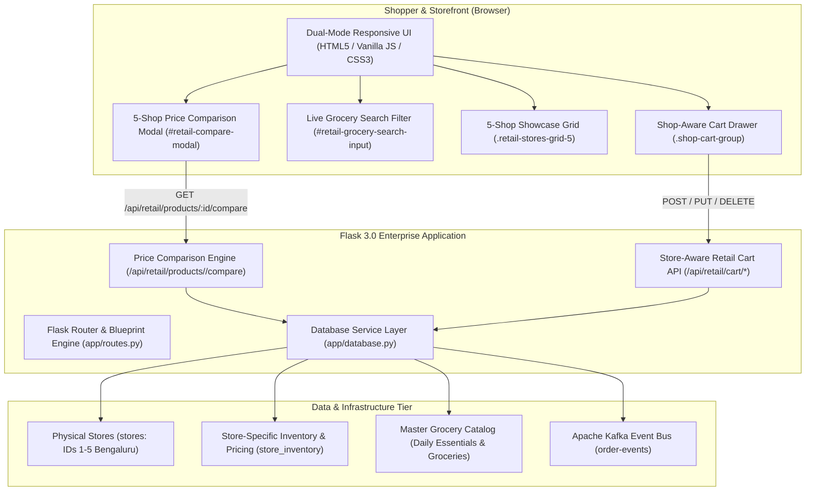

# BharatStore 🇮🇳 | Dual-Mode Omni-Channel Retail Platform & Marketplace

[](https://www.python.org/downloads/)
[](https://palletsprojects.com/p/flask/)
[](https://aiven.io/postgresql)
[](https://aiven.io/kafka)
[](https://aiven.io/opensearch)
[-brightgreen.svg)](#-automated-testing--verification)
[](LICENSE)

**BharatStore** is a modern, location-aware, dual-mode e-commerce and quick-commerce platform designed for India's retail ecosystem. It bridges physical neighborhood grocery stores and supermarkets with an enterprise-scale online marketplace. Customers experience the hyper-local speed of quick commerce (Zepto / Swiggy Instamart / Blinkit) alongside the nationwide selection of a full marketplace (Amazon / Flipkart) — unified within a single Flask-driven platform.

> **Key Proposition for Retail Near Me:**  
> *"Compare prices across five neighbourhood shops and buy at the price you prefer."*

---

## 📑 Table of Contents

- [1. Project Introduction](#1-project-introduction)
- [2. Dual Shopping Modes](#2-dual-shopping-modes)
- [3. Key Platform Capabilities](#3-key-platform-capabilities)
- [4. Five-Shop Retail Grocery Marketplace & Price Comparison](#4-five-shop-retail-grocery-marketplace--price-comparison)
- [5. Multi-Store Inventory Foundation](#5-multi-store-inventory-foundation)
- [6. Technology Stack](#6-technology-stack)
- [7. Architecture Diagram](#7-architecture-diagram)
- [8. Database Schema & Relational Design](#8-database-schema--relational-design)
- [9. Installation & Local Setup (Windows PowerShell)](#9-installation--local-setup-windows-powershell)
- [10. Environment Configuration](#10-environment-configuration)
- [11. REST API Documentation](#11-rest-api-documentation)
- [12. Automated Testing & Verification](#12-automated-testing--verification)
- [13. Project Roadmap](#13-project-roadmap)
- [14. Security & Concurrency Controls](#14-security--concurrency-controls)
- [15. Contributors & Collaboration](#15-contributors--collaboration)
- [16. License](#16-license)

---

## 1. Project Introduction

### Overview & Problem Statement
Traditional e-commerce platforms force physical retailers to operate as distant drop-shippers with standardized national pricing, masking physical store inventory, local discounts, and hyper-local delivery capability. Conversely, quick-commerce apps restrict shoppers to micro-warehouses (dark stores) without access to comprehensive product ranges, price comparisons between neighborhood shops, or high-ticket electronics.

### Project Objectives
1. **Unify Quick Commerce & National Marketplace:** Seamlessly switch between physical store delivery (within 15 km) and nationwide marketplace fulfillment without cart cross-contamination.
2. **Five-Shop Grocery Price Comparison:** Allow customers to browse five verified neighborhood grocery shops in Bengaluru, compare real-time prices on everyday essentials, and purchase from the store offering the best price.
3. **True Multi-Store Inventory & Pricing:** Allow physical stores to stock the same products at independent prices (with realistic ₹1–₹3 variances) and isolated stock levels (including out-of-stock isolation).
4. **Resilient Dual-Engine Architecture:** Operate zero-config locally using ACID SQLite, local fuzzy OpenSearch emulation, and in-process Kafka streams, while seamlessly scaling to Aiven Managed PostgreSQL, Kafka, and OpenSearch in production.

---

## 2. Dual Shopping Modes

| Feature / Dimension | 🛒 Mode A: Retail Near Me | 🌐 Mode B: Online Shopping |
| :--- | :--- | :--- |
| **Experience Inspiration** | Zepto, Swiggy Instamart, Blinkit, Local Shops | Amazon.in, Flipkart |
| **Catalog & Products** | Strictly Daily Groceries, Dairy, Staples & Produce (0 Electronics) | Full 7-category marketplace catalog (Laptops, Mobiles, Apparel, Home) |
| **Fulfillment Source** | 5 Verified Bengaluru neighborhood physical retail shops | Central regional fulfillment mega-hubs |
| **Pricing Engine** | Physical shop-specific selling price (₹1–₹3 variations) | National catalog selling price |
| **Price Comparison** | Real-time 5-shop price comparison modal & lowest price badges | Single marketplace price with coupon discounts |
| **Stock Tracking** | Real-time `store_inventory` row-level stock | Central `inventory` double-entry ledger |
| **Delivery Radius** | Strict 15 km local radius with 2-Hour Express Delivery | Nationwide delivery across India |
| **Cart Isolation** | Retains local shop items with shop-wise subtotals | Retains marketplace items independently |
| **Fulfillment Options**| 2-Hour Express Doorstep Delivery (₹20) or Free Store Pickup | Standard Courier & Surface Logistics |

---

## 3. Key Platform Capabilities

- **Editorial Design System:** High-contrast palette (`#A56211` Warm Honey Gold, `#004B8D` Royal Navy, `#2C2621` Espresso) with Playfair Display and Plus Jakarta Sans typography.
- **Persistent Theme Toggle:** Accessible Light and Dark modes with automatic OS `prefers-color-scheme` synchronization.
- **Smart OpenSearch Bar:** Live fuzzy autocomplete suggestions with typo tolerance (`bluetoth` $\to$ Sony WH-1000XM5, `lapop` $\to$ Dell XPS 13).
- **Location & Address Book (Phase 3):**
  - High-precision GPS Geolocation API with Haversine distance math.
  - Interactive Location Selector Modal (`#location-selector-modal`) supporting 6 Indian metro hubs (Mumbai, Bengaluru, Delhi NCR, Hyderabad, Chennai, Kolkata).
  - Saved Delivery Addresses book with default toggles, phone validation, and checkout auto-fill.
- **Live Event Stream Inspector (`/architecture`):** Real-time Server-Sent Events (SSE) reflecting Kafka events directly in the browser.

---

## 4. Five-Shop Retail Grocery Marketplace & Price Comparison

The Retail Near Me storefront has been transformed into a hyper-local grocery shopping and price comparison platform:

### 1. Five Verified Bengaluru Retail Shops
Customers can switch between five authentic neighborhood grocery stores located across prime Bengaluru localities:
1. **Bharat Fresh Mart** (Store ID: 1, Indiranagar, 12.9784, 77.6408) — *Rating: 4.8★, Delivery: 15-20 min, Min Order: ₹99*
2. **Daily Needs Supermarket** (Store ID: 2, Koramangala, 12.9352, 77.6245) — *Rating: 4.6★, Delivery: 25-30 min, Min Order: ₹149*
3. **Green Basket Grocery** (Store ID: 3, HSR Layout, 12.9121, 77.6446) — *Rating: 4.9★, Delivery: 20-25 min, Min Order: ₹99*
4. **Sri Lakshmi Stores** (Store ID: 4, Jayanagar, 12.9308, 77.5838) — *Rating: 4.7★, Delivery: 30-35 min, Min Order: ₹199*
5. **Smart Choice Supermarket** (Store ID: 5, Whitefield, 12.9698, 77.7500) — *Rating: 4.5★, Delivery: 35-40 min, Min Order: ₹249*

### 2. Strict Grocery-Only Isolation
The Retail storefront strictly filters catalog items to `category == "Daily Essentials & Groceries"`. Laptops, smartphones, audio gear, apparel, and non-grocery merchandise are strictly excluded from `/retail`.

### 3. Comprehensive 50+ Everyday Grocery Catalog
Over 60 everyday grocery items organized across five essential departments:
- **Dairy & Breakfast (13 items):** Amul Taaza Milk 1L, Amul Gold Milk 500ml, Mother Dairy Milk 1L, Fresh Curd 500g, Amul Masti Dahi 400g, Paneer 200g, Amul Butter 100g, Amul Pure Ghee 500ml, Cheese 200g, Bread, Eggs, Oats, Corn Flakes.
- **Rice & Grains (11 items):** Basmati Rice 1kg, Regular Rice 5kg, Wheat Atta 5kg, Toor Dal 1kg, Moong Dal 1kg, Chana Dal, Urad Dal, Rajma, Poha, Besan, Suji.
- **Cooking Essentials (12 items):** Sunflower Oil 1L, Mustard Oil 1L, Sugar 1kg, Salt 1kg, Turmeric Powder, Red Chilli Powder, Coriander Powder, Garam Masala, Tea, Coffee, Cumin Seeds, Mustard Seeds.
- **Fresh Produce (10 items):** New Crop Potatoes 1kg, Nasik Red Onions 1kg, Hybrid Tomatoes 1kg, Robusta Bananas 1 Dozen, Coriander Bunch, Green Chillies, Ginger, Apples, Oranges, Capsicum.
- **Household Essentials (8 items):** Surf Excel Easy Wash 1kg, Vim Dishwash Gel 500ml, Lizol Floor Cleaner 1L, Dettol Handwash 675ml, Harpic 1L, Colin Glass Cleaner, Goodknight Refill, Scotch-Brite Sponges.

### 4. Real Database Store-Specific Pricing & Stock Variance
Prices reflect real-world market variations with realistic ₹1–₹3 variances:
- *Amul Taaza Milk 1L:* ₹60 at Bharat Fresh Mart vs ₹62 at Daily Needs Supermarket.
- *Amul Pure Ghee 500ml:* ₹310 at Store 1, ₹312 at Store 3, ₹309 at Store 4 (Lowest price!).
- *Paneer 200g:* ₹95 at Store 1, ₹92 at Store 3 (Lowest), ₹98 at Store 2, and Out of Stock at Store 4.
- *Out-of-Stock Isolation:* Store 2 has Curd and Ghee out of stock; Store 4 has Paneer out of stock. Customers cannot add out-of-stock items, while other shops maintain active stock.

### 5. Interactive 5-Shop Price Comparison Modal
Every product card features a **"Compare 5 Shops"** button. Clicking opens a real-time comparison modal showing:
- Image, title, unit pack size.
- Real-time price breakdown across all 5 Bengaluru shops.
- Green badge highlighting the shop offering the **Lowest Price** along with the exact rupee savings.
- Per-shop stock status (In Stock with count vs Out of Stock).
- Direct **"Buy from Shop"** action button for immediate fulfillment from the selected store.

### 6. Shop-Aware Cart with Subtotals & Fulfillment Selection
- Cart items are tagged with `store_id` and `store_name`.
- Cart drawer dynamically groups items by shop with individual shop subtotals.
- Customers can toggle between **2-Hour Express Delivery (₹20)** and **Free Store Pickup** per shop.

---

## 5. Multi-Store Inventory Foundation

Phase 4 establishes complete inventory decentralization across physical retail stores:

1. **Physical Store Database (`stores`):** Captures store details, unique slug, owner, verified contact phone, GPS coordinates, opening/closing hours, active status, and delivery/pickup availability.
2. **Multi-Store Inventory Engine (`store_inventory`):** Maps `(store_id, product_id)` with independent selling prices, stock quantities, reserved counts, and low-stock alerts.
3. **Overselling & Concurrency Protection:** Atomic row-level stock decrements (`stock_quantity = stock_quantity - ? WHERE stock_quantity >= ?`) and reservations preventing race conditions.
4. **Admin Foundation:** Protected APIs for store registration, inline inventory updates, stock restocking, and low-stock threshold queries.

---

## 6. Technology Stack

- **Backend Framework:** Python 3.10+, Flask 3.0.0, Flask-CORS 4.0.0
- **Database Engine:**
  - *Cloud Production:* Aiven Managed PostgreSQL (`psycopg2-binary`)
  - *Local Development Fallback:* ACID-compliant SQLite 3 (`sqlite3`) with row factories and WAL mode
- **Event Streaming:** Apache Kafka (`kafka-python-ng`) with real-time browser SSE broadcasting
- **Search Engine:** OpenSearch 2.x (`opensearch-py`) with typo-tolerant fuzzy multi-match DSL
- **Frontend / UI:** Vanilla JavaScript (ES6+), HTML5, CSS3 Custom Properties, Jinja2 template inheritance
- **Security & Cryptography:** HMAC SHA-256 timing-safe token authentication, `secrets.token_hex(32)`, parameterized SQL injection guards

---

## 7. Architecture Diagram



---

## 8. Database Schema & Relational Design

The system implements relational tables with strict referential integrity:

```
┌───────────────────────────┐             ┌───────────────────────────┐
│          stores           │             │         products          │
├───────────────────────────┤             ├───────────────────────────┤
│ id (PK)                   │             │ id (PK)                   │
│ store_name                │             │ sku (UNIQUE)              │
│ store_slug (UNIQUE)       │             │ title                     │
│ full_address              │             │ brand                     │
│ city, area, pincode       │             │ category                  │
│ latitude, longitude       │             │ sub_category              │
│ rating, delivery_time     │             │ price (national default)  │
│ min_order, is_active      │             │ image_url                 │
└─────────────┬─────────────┘             └─────────────┬─────────────┘
              │                                         │
              │         ┌─────────────────────┐         │
              └────────►│   store_inventory   │◄────────┘
                        ├─────────────────────┤
                        │ id (PK)             │
                        │ store_id (FK)       │
                        │ product_id (FK)     │
                        │ selling_price       │
                        │ original_price      │
                        │ stock_quantity      │
                        │ reserved_quantity   │
                        │ low_stock_threshold │
                        │ is_available        │
                        │ UNIQUE(store, prod) │
                        └─────────────────────┘
```

---

## 9. Installation & Local Setup (Windows PowerShell)

Follow these steps to run BharatStore locally:

### 1. Clone the repository
```powershell
git clone https://github.com/ayush35099-cloud/BharatStore.git
Set-Location BharatStore
```

### 2. Prepare Virtual Environment
```powershell
python -m venv .venv
.\.venv\Scripts\Activate.ps1
```

### 3. Install Dependencies
```powershell
pip install -r requirements.txt
```

### 4. Configure Environment Variables
```powershell
Copy-Item .env.example .env
```

Generate cryptographically secure keys:
```powershell
python -c "import secrets; print('SECRET_KEY=' + secrets.token_hex(32)); print('ADMIN_API_KEY=' + secrets.token_hex(32))"
```
Open `.env` in your editor and paste your generated keys.

### 5. Run Database Migrations
Migrations run **automatically and idempotently** on server startup. To verify manually:
```powershell
python -m unittest tests/test_retail_price_comparison.py
```

### 6. Start the Flask Application
```powershell
python run.py
```

Open your browser to:
- **Homepage:** [http://127.0.0.1:5000/](http://127.0.0.1:5000/)
- **Retail Near Me (5-Shop Comparison):** [http://127.0.0.1:5000/retail](http://127.0.0.1:5000/retail)
- **Online Marketplace:** [http://127.0.0.1:5000/?view=online](http://127.0.0.1:5000/?view=online)
- **Mode Selector:** [http://127.0.0.1:5000/select-mode](http://127.0.0.1:5000/select-mode)
- **Architecture & Streaming Inspector:** [http://127.0.0.1:5000/architecture](http://127.0.0.1:5000/architecture)

---

## 10. Environment Configuration

| Variable | Required | Default / Fallback | Description |
| :--- | :---: | :--- | :--- |
| `PORT` | Optional | `5000` | Port for the local Flask server |
| `SECRET_KEY` | **Required** | *Auto-generated on launch* | Cryptographic 256-bit key for session signing |
| `ADMIN_API_KEY` | **Required** | `""` | Timing-safe secret token for administrative APIs |
| `MAX_QUANTITY_PER_ITEM`| Optional | `50` | Maximum units per cart line item |
| `ALLOW_INSECURE_TEST_ENDPOINTS` | Optional | `false` | Security guard to disable mock routes in production |
| `AIVEN_PG_URL` | Optional | *SQLite local fallback* | PostgreSQL connection string for Aiven Cloud |
| `AIVEN_KAFKA_BOOTSTRAP_SERVERS`| Optional | *In-memory SSE stream* | Apache Kafka bootstrap broker addresses |
| `AIVEN_OPENSEARCH_URL` | Optional | *Local fuzzy DSL engine* | OpenSearch cluster endpoint |
| `RAZORPAY_KEY_ID` | Optional | *Simulated checkout* | Razorpay API key ID for live transactions |

---

## 11. REST API Documentation

### Retail Near Me & Price Comparison Endpoints

#### `GET /api/retail/stores`
Returns the five Bengaluru neighbourhood shops with live delivery time, ratings, and min order thresholds.
```json
{
  "success": true,
  "total_stores": 5,
  "city": "Bengaluru",
  "stores": [
    {
      "id": 1,
      "store_name": "Bharat Fresh Mart",
      "area": "Indiranagar",
      "rating": 4.8,
      "delivery_time": "15-20 min",
      "min_order": 99.0
    }
  ]
}
```

#### `GET /api/retail/catalog`
Returns the dynamic retail grocery-only catalog grouped by essential departments, including active store details and top savings deals.
```json
{
  "success": true,
  "dairy_items": [...],
  "grains_items": [...],
  "essentials_items": [...],
  "produce_items": [...],
  "household_items": [...],
  "top_deals": [...]
}
```

#### `GET /api/retail/products/<product_id>/compare`
Calculates real-time price comparison across all five neighbourhood shops for a specific grocery product.
```json
{
  "success": true,
  "product": {
    "id": 79,
    "title": "Amul Pure Ghee – 500 ml",
    "pack_size": "500 ml"
  },
  "lowest_price": 309.0,
  "highest_price": 312.0,
  "max_savings": 3.0,
  "lowest_store_id": 4,
  "lowest_store_name": "Sri Lakshmi Stores",
  "stores_comparison": [
    {
      "store_id": 1,
      "store_name": "Bharat Fresh Mart",
      "selling_price": 310.0,
      "stock_quantity": 25,
      "is_available": true,
      "is_lowest": false
    },
    {
      "store_id": 4,
      "store_name": "Sri Lakshmi Stores",
      "selling_price": 309.0,
      "stock_quantity": 30,
      "is_available": true,
      "is_lowest": true
    }
  ]
}
```

#### `POST /api/retail/cart/add`
Adds a product to the retail basket from a designated physical store with inventory and out-of-stock validation.
```json
// Request Body
{
  "product_id": 61,
  "store_id": 1,
  "quantity": 2,
  "store_name": "Bharat Fresh Mart",
  "fulfillment": "delivery"
}
```

#### `GET /api/retail/cart`
Returns the active retail cart grouped by shop with calculated subtotals, fulfillment breakdown, and grand totals.

#### `PUT /api/retail/cart/update`
Updates quantity or fulfillment mode (`delivery` / `pickup`) for a specific shop item.

#### `DELETE /api/retail/cart/remove`
Removes an item from the shop-aware retail cart.

---

## 12. Automated Testing & Verification

All 90 automated tests across Phase 1, Phase 2, Phase 3, Phase 4, and Retail Price Comparison are executed and verified:

```powershell
python -m unittest discover tests -v
```

### Verified Test Summary

```text
----------------------------------------------------------------------
Ran 90 tests in 6.421s

OK (100% Passed)
```

- **Retail 5-Shop Price Comparison Suite (`tests/test_retail_price_comparison.py`):** 10 / 10 PASS
  - 5 Bengaluru stores registered with exact coordinates and metadata.
  - Strict grocery-only isolation verified (0 non-grocery items on `/retail`).
  - 50+ grocery products verified across 5 essential departments.
  - Per-store independent pricing & realistic ₹1–₹3 variances verified.
  - Out-of-stock isolation across shops strictly enforced.
  - Real-time 5-shop price comparison API calculated lowest price & savings.
  - Store-aware retail cart API operations (add, oos rejection, shop grouping, remove).
  - Retail Near Me homepage DOM verified (5-shop grid, search bar, banner, modal).
  - Online Shopping marketplace catalog integrity confirmed intact.
- **Retail Grocery Catalog Suite (`tests/test_retail_grocery_catalog.py`):** 9 / 9 PASS
  - Essential Dairy, Grains, and Cooking Essentials existence in DB.
  - First-screen rendering of Milk, Curd, Ghee, Butter, Paneer, and Cheese.
  - Store 2 out-of-stock badges and Store 2 subtitle compatibility.
- **Phase 4 Multi-Store Inventory Suite (`tests/test_phase4_store_inventory.py`):** 21 / 21 PASS
  - Store creation, retrieval, updates, activation/deactivation cycles.
  - Independent store pricing and out-of-stock isolation.
  - Concurrency safety, overselling prevention, and stock reservation lifecycle.
- **Phase 3 Location & Addresses Suite (`tests/test_phase3_location_management.py`):** 21 / 21 PASS
  - GPS coordinates validation, Indian PIN / phone regex, customer ownership (IDOR).
- **Phase 2 Shopping Modes Suite (`tests/test_phase2_shopping_modes.py`):** 17 / 17 PASS
  - Dual-mode session switching, cart separation, modal confirmations.
- **Phase 2 Product Details Suite (`tests/test_phase2_product_detail.py`):** 12 / 12 PASS
  - 18 Phase 1 modules regression guard, OpenSearch fuzzy typo tolerance.

---

## 13. Project Roadmap

- [x] **Phase 1: Platform Foundation & Core E-Commerce** (18 modules, Aiven Cloud integrations, dual SQLite/PG engine).
- [x] **Phase 2: Dual Shopping Mode Selection Engine** (Retail Near Me ⇄ Online Shopping, isolated carts).
- [x] **Phase 3: Location and Address Management** (GPS detection, 6 metro hubs, address book CRUD, zero horizontal scroll).
- [x] **Phase 4: Store Database & Multi-Store Inventory** (Physical store models, independent pricing, overselling protection).
- [x] **Retail Near Me 5-Shop Price Comparison Marketplace** (5 Bengaluru shops, 50+ groceries, 5-shop compare modal, shop-aware cart).
- [ ] **Phase 5: Hyper-Local Store Discovery & 15 km Radius Routing** (Map views, dynamic distance routing, delivery tiers).
- [ ] **Phase 6: Admin Store Portal & Partner Merchant Dashboard** (Merchant web UI, inventory reconciliation, order dispatch).

---

## 14. Security & Concurrency Controls

1. **Timing-Safe HMAC Authentication:** Administrative API endpoints verify credentials using `hmac.compare_digest` to prevent side-channel timing attacks.
2. **ACID Concurrency & Row Locking:** Store stock reservations use atomic decrements and row-level locks (`FOR UPDATE` on PostgreSQL; immediate transactions on SQLite) to prevent overselling under high concurrency.
3. **Insecure Direct Object Reference (IDOR) Protection:** Address operations verify `customer_id` ownership, returning `404 Not Found` for unauthorized tampering attempts.
4. **Injection Defenses:** Parameterized queries (`?` on SQLite, `%s` on PostgreSQL) ensure immunity against SQL injection attacks.
5. **Zero-Secret Public Codebase:** `.env` is strictly git-ignored; sample configuration uses placeholders only.

---

## 15. Contributors & Collaboration

- **Ayush Anjan Choudhary** ([@ayush35099-cloud](https://github.com/ayush35099-cloud)) — *Full-Stack Architecture, Database Engineering & Cloud Infrastructure*
- **Team Collaborators** — *Frontend UI/UX, Component Theming & Voice Search Integrations*

---

## 16. License

This project is licensed under the terms of the [MIT License](LICENSE).

---

*BharatStore 🇮🇳 — Physical Stores Across India, Now Online.*
